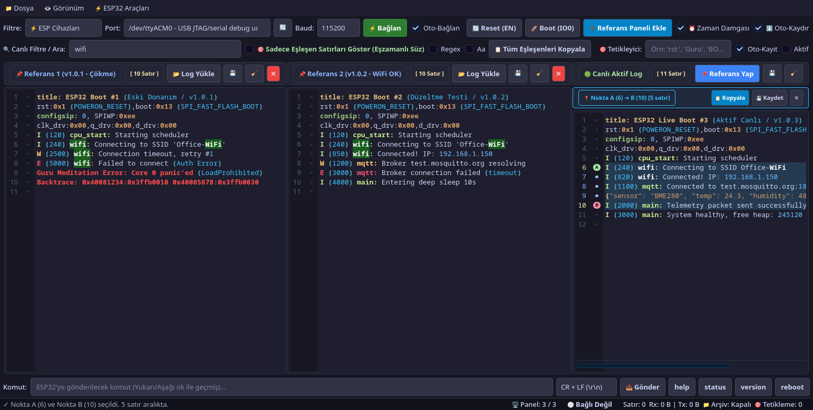
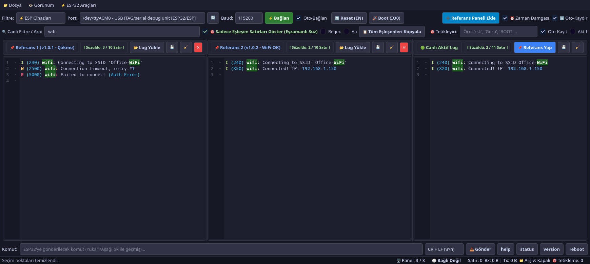

# ESP32 Serial Capture & Monitor Pro 🚀

ESP32, ESP8266, Arduino ve genel gömülü sistemler için geliştirilmiş, Python ve PyQt6 tabanlı gelişmiş seri port izleme, 3'lü yan yana karşılaştırma, arşivleme ve analiz aracı.


*3 Panelli Yan Yana Karşılaştırma ve Gerçek Zamanlı Analiz*


*Eşzamanlı Satır Filtreleme — Tüm Panellerde Sadece İlgili Satırları Gösterme*

---

## 🌟 Öne Çıkan Özellikler

### 1. 🖥️ 3 Taneye Kadar Yan Yana Log Alanı (Multi-Pane QSplitter)
- **1, 2 veya 3 Panel**: Üst çubuktaki **"➕ Referans Paneli Ekle"** butonu veya `Ctrl+N` ile ekranınızı 1, 2 veya 3 bağımsız panele bölebilirsiniz.
- **"📌 Referans Yap" Butonu (`Ctrl+R`)**: Canlı akan logu tek tıkla sola dondurulmuş bir referans paneline aktarır ve sağdaki aktif paneli yeni test için hazırlar.
- **Eski Log Yükleme**: Referans panellerindeki **"📂 Log Yükle"** düğmesi ile geçmiş arşiv veya kayıt dosyaları anında yüklenebilir.
- Her panel bağımsız **Nokta A-B aralık seçiciye** ve kaydetme düğmelerine sahiptir.

### 2. 🎯 Eşzamanlı Satır Filtreleme ("Sadece Eşleşen Satırları Göster")
- Arama kutusuna bir kelime (örn: `wifi`, `Guru`, `mqtt`, `[E]`, `rst:0x1`) yazıp **"🎯 Sadece Eşleşen Satırları Göster (Eşzamanlı Süz)"** seçeneğini açtığınızda:
  - **Açık olan 3 panelin tamamı eşzamanlı olarak süzülür!**
  - Tüm panellerdeki gereksiz satırlar gizlenir, sadece ilgili kelimeyi içeren satırlar yan yana gösterilir.
  - Farklı çalıştırmalardaki hata, uyarı veya önyükleme adımları anında satır satır kıyaslanabilir.
  - Filtre kapatıldığında orijinal loglar anında geri yüklenir.
- **Çapraz Kelime Vurgulama**: Bir panelde tıklanan kelime tüm açık panellerde senkronize olarak parlar.

### 3. 🎯 Cihaz Keşfi ve Son Bağlanan Cihazı Hatırlama
- **Otomatik Algılama & Filtreleme**: ESP32 (Espressif JTAG / CDC, CP210x, CH340, FTDI) ve Arduino cihazlarını USB VID/PID donanım tanımlarına göre otomatik tanır.
- **Akıllı Hatırlama**: Son bağlandığınız seri portu, baud rate hızını ve ayarları hatırlar.
- **Otomatik Yeniden Bağlanma (Auto-Reconnect)**: Cihaz kablosu çıkarılıp takıldığında portu yeniden yakalar.

### 4. 🎨 Gelişmiş Sözdizimi Renklendirmesi (Syntax Highlighting)
- **Rakamlar & Değerler**: Onaltılık (`0x1A2B`, bellek adresleri), ondalık sayılar (`12.34`) parlak cyan ve altın tonlarıyla vurgulanır.
- **Başlıklar & Etiketler**: `"title: ..."` başlıkları, önyükleme bayrakları (`rst:`, `boot:`, `clk:`, vb.) ve `Guru Meditation Error` çökmeleri belirgin renkle gösterilir.
- **Parantezler ve İçerikleri**: `(...)`, `[...]`, `{...}` parantezleri ve iç kısımları farklı renklerle ayrıştırılır.
- **ESP-IDF Log Seviyeleri**: `[E]`, `[W]`, `[I]`, `[D]`, `[V]` hata, uyarı, bilgi, debug seviyelerine göre renklendirilir.

### 5. 📍 Satır Başlarında Tıklama Noktaları (Aralık Seç ve Kopyala)
- Her satırın sol kenarında (gutter) tıklanabilir noktalar yer alır.
- **1. Tıklama (Nokta A)**: Yeşil **'A'** rozeti koyar.
- **2. Tıklama (Nokta B)**: Kırmızı **'B'** rozeti koyar.
- İki nokta arasındaki tüm satırlar seçilir ve açılan banttan tek tıkla kopyalanabilir veya kaydedilebilir.

### 6. 📦 Sürekli Oturum Arşivleme & Arşiv Yöneticisi (`Ctrl+H`)
- Bağlantı açıldığı anda `archives/ESP32_{port}_{zaman_damgası}.log` dosyasına tüm akış gerçek zamanlı yazılır.
- Arşiv Yöneticisi penceresinden geçmiş tüm loglar incelenebilir, filtrelenebilir, **"📌 Referans Olarak Aç"** düğmesiyle veya çift tıklamayla doğrudan referans paneline aktarılabilir.

### 7. 🔥 Tetikleyici Kelime ile Kayıt Başlatma (Trigger Recording)
- Belirlenen bir tetikleyici kelime görüldüğünde ekrana bildirim çizgisi eklenir ve isteğe bağlı olarak ayrı bir dosyaya otomatik kayıt başlatılır.

### 8. ⚡ ESP32 Donanım Kontrol Araçları & Kesintisiz İzleme
- **Kesintisiz İzleme (Arduino Serial Monitor Modu)**: Varsayılan olarak seri porta bağlanırken DTR/RTS hatları manipüle edilmez. Tıpkı Arduino Serial Monitor gibi, halihazırda çalışan ESP32/Arduino cihazınız resetlenmeden kesintisiz akmaya devam eder.
- **"Resetle" (Bağlantıda Reset) Onay Kutusu**: Doğrudan **⚡ Bağlan** butonunun yanında yer alır. İşaretlendiğinde ilk bağlantıda cihazı donanımsal olarak resetleyerek önyükleme (boot) loglarını en baştan yakalar.
- **Reset (EN Pin)** (`F5`): DTR/RTS zamanlaması ile ESP32'yi donanımsal yeniden başlatır.
- **Bootloader (IO0 Pin)** (`F6`): ESP32'yi ROM indirme / flaşlama moduna alır.
- **Komut Gönderme Çubuğu**: Komut geçmişi hafızası ve satır sonu seçenekleri.

### 9. 🌐 Çoklu Dil Desteği (Türkçe & English)
- Menü çubuğundan (`🌐 Dil / Language`) tek tıkla **Türkçe** veya **English** dilleri arasında dinamik geçiş yapılabilir.
- Tüm arayüz (başlıklar, menüler, araç çubukları, arşiv yöneticisi, bildirimler ve uyarılar) anında seçilen dile çevrilir.
- Dil tercihi `config.json` içine kaydedilir ve sonraki açılışlarda hatırlanır.

---

## 💻 Kurulum & Çalıştırma

### Gereksinimler
- Python 3.10+
- `pip install -r requirements.txt`

### Başlatma
```bash
git clone https://github.com/metegokhan/esp32-serial-monitor-pro.git
cd esp32-serial-monitor-pro
pip install -r requirements.txt
python3 main.py
```

Linux için doğrudan launcher ile başlatılabilir:
```bash
./run.sh
```

---

## 📄 Lisans
Bu proje [MIT Lisansı](LICENSE) altında lisanslanmıştır.
